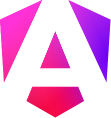

  

# Developer Interview Questions

Modern interview questions and answers for developers.

## Motivation

In many cases, an Internet search gives old content that is no longer relevant.

I wanted to collect a list that is up to date.

**Every link in this file is from 2026.**

## Frontend

- [100+ React Interview Questions Straight from Ex-interviewers (2026)](https://www.greatfrontend.com/blog/100-react-interview-questions-straight-from-ex-interviewers)
- [Angular Interview Questions (2026): From Fundamentals to Senior-Level Scenarios](https://arc.dev/employer-blog/angular-interview-questions-from-fundamentals-to-senior-level-scenarios/)
- [TypeScript Interview Questions for Senior Developers (2026)](https://www.greatfrontend.com/blog/typescript-interview-questions-for-senior-frontend-developers)

## Backend

- [Senior Node.js Developer Interview Questions: Advanced Topics and Answers](https://www.greatfrontend.com/blog/senior-nodejs-developer-interview-questions-advanced-topics-and-answers)
- [Senior REST API Developer Interview Questions: Advanced Topics and Answers](https://www.greatfrontend.com/blog/senior-rest-api-developer-interview-questions-advanced-topics-and-answers)
- [Java Interview Questions and Answers for 2 to 3 years Experienced: Top 50](https://www.founditgulf.com/career-advice/java-interview-questions-and-answers-for-2-to-3-years-experience/)

## License

### Article

Please see the [LICENSE file](LICENSE).

### Developer icons

Please see the [LICENSE file in img/devicons/](img/devicons/LICENSE).

## History

I made the first version on 20th June, 2024.
